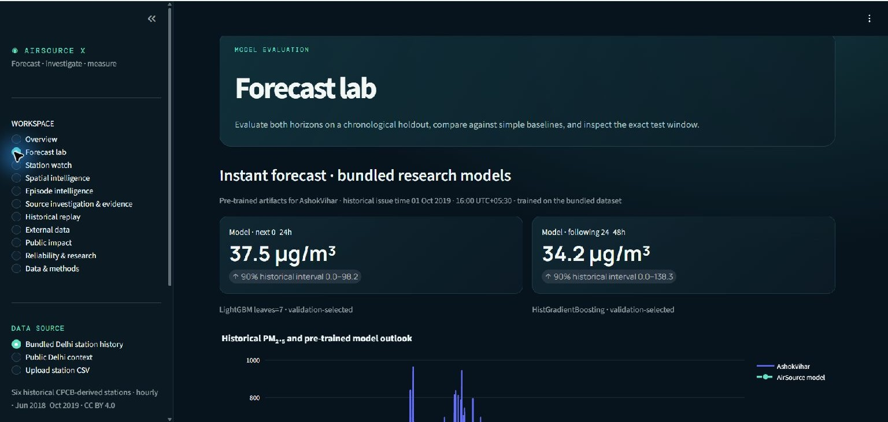

# AirSource X

**Forecast the pollution. Investigate the evidence. Make uncertainty visible.**

AirSource X is a Delhi-first environmental intelligence prototype for PM₂.₅ forecasting, station comparison, anomaly screening, and transparent investigation of possible pollution influences. It is designed to show what the available data supports, what it contradicts, and what is still missing.

> **Research prototype:** AirSource X is not an official forecast, source-apportionment system, health diagnosis, or safety alert. A screening pattern is not proof of an emission source. Its bundled results are a retrospective benchmark on a historical, author-curated dataset—not current-air performance or evidence of transfer to other stations or seasons.

## Neural Storm 2026 submission

| Field | Details |
|---|---|
| Track / problem | Track 2: Green Planet · GP-01 Air Quality Monitoring & Source Attribution |
| Team name | **Fresh_coderz** |
| Team members | Shylan Kamesh S, Sai Santhosh T, Derin Godson |
| Public source repository | [github.com/shylankamesh/airsource-x](https://github.com/shylankamesh/airsource-x) · Streamlit V8 source on `main` |
| Live demo | [Open the public Cloud Run demo](https://airsource-x-605775397403.asia-south1.run.app/) · Forecast Lab preview verified |
| Demo screenshots / GIF | [Forecast Lab live capture](assets/screenshots/cloud-run-forecast.jpg) |
| Submission deadline | 4 November 2026, 8:00 PM IST |

## The problem

Air-quality dashboards can display pollutant values without showing whether an episode is shared across monitors, which competing explanations are consistent with observations, or what important measurements are unavailable. Dust, combustion emissions, regional transport, and weather can overlap. A nearby road, factory, or fire is not enough to establish why a monitor recorded a concentration.

## What AirSource X does

- **Two-horizon PM₂.₅ forecast:** forecasts mean concentration for the next 0–24 hours and the following 24–48 hours from station history.
- **Validation-selected ML:** compares three regularized LightGBM configurations and HistGradientBoosting over three purged expanding-window validation folds, chooses by mean validation MAE, then evaluates on a later untouched test period.
- **Calibrated uncertainty:** estimates 90% split-conformal interval width on a separate later calibration block and reports actual holdout coverage and mean width. Seasonal shifts can reduce coverage; the nominal level is not guaranteed.
- **Honest baselines:** compares the selected model with persistence and a weekly same-horizon naive forecast on the same chronological test issue times; the 48-hour purge protects the longer horizon.
- **Bundled station evidence:** includes six historical Delhi station series (70,227 hourly rows, June 2018–October 2019), with data attribution, license, preparation scripts, and measured temporal holdout results.
- **Instant reproducible demo:** for the exact bundled dataset, Forecast lab loads the matching station model artifacts and displays the historical forecast and holdout comparison immediately. The full evaluation button still runs a fresh validation, calibration, and fit.
- **Provider context:** fetches a keyless 48-hour Open-Meteo air-quality and weather outlook for Delhi, with Open-Meteo/CAMS attribution. Provider estimates are visibly separated from ground-monitor observations and are never treated as model-validation truth.
- **Station watch:** compares synchronized station readings and uses Isolation Forest to flag unusual multivariate rows. A flagged row is not a confirmed incident.
- **Evidence room:** screens dust-like coarse-particle, combustion-compatible co-pollutant, and regional-versus-local patterns; exposes contradictions and missing evidence; and abstains when coverage is insufficient.
- **Counterfactual evidence removal:** remove an evidence family and recompute the screening cards to inspect sensitivity. This is a software sensitivity check, not a causal intervention.
- **Next-best measurement:** recommends a transparent follow-up observation based on the evidence gaps.
- **Historical replay:** filter records by explicit observation and availability times; missing availability timestamps are not guessed.
- **Public impact & decisions:** produce a user-threshold review brief for human verification, not official AQI or health advice.
- **Reliability & research:** inspect the packaged holdout benchmark and locally recorded ingestion freshness.
- **External context:** OpenAQ and NASA FIRMS connectors with explicit data-class separation; FIRMS proximity is not source attribution.
- **Provenance exports:** download model metrics and investigation records as CSV/JSON.

## Research choices

The project preserves the proposal's differentiators: multi-station spatial context, evidence-aware investigation with abstention, next-best-measurement decision support, reliability and operational traceability. FIRMS contextual integration is implemented; TROPOMI/MAIAC ingestion and trajectory modelling remain future work.

The product study and implementation choices are documented in [docs/REFERENCE_STUDY.md](docs/REFERENCE_STUDY.md). Forecast definitions, time splitting, evidence thresholds, and limits are in [docs/METHODOLOGY.md](docs/METHODOLOGY.md). Data citation, CC BY 4.0 attribution, preparation, and temporal validation protocol are in [docs/DATA_PROVENANCE.md](docs/DATA_PROVENANCE.md).

## Technology

- Python 3.11
- Streamlit, pandas, NumPy, Plotly
- Validation-selected LightGBM candidates with scikit-learn HistGradientBoosting fallback
- scikit-learn Isolation Forest
- SHAP provides an on-demand local predictive explanation when supported by the installed model; it is explicitly separated from physical source attribution
- Open-Meteo Air Quality and Forecast APIs for provider-modelled context

## Setup

Clone the public repository and create a virtual environment:

```bash
git clone https://github.com/shylankamesh/airsource-x.git
cd airsource-x
python -m venv .venv
```

Activate the environment:

```bash
# Windows PowerShell
.venv\Scripts\Activate.ps1

# macOS / Linux
source .venv/bin/activate
```

Install packages and launch:

```bash
python -m pip install --upgrade pip
pip install -r requirements.txt
streamlit run app.py
```

Open the local URL printed by Streamlit. The default bundled historical station dataset and model evaluation run locally. Fetching the separate Open-Meteo provider context needs an internet connection and no API key.

Reproduce the six-station training and holdout report:

```bash
python scripts/benchmark_public_dataset.py
```

This performs three-fold validation-only candidate selection, separate interval calibration, and untouched temporal holdout scoring for every bundled station. To regenerate the prepared CSV from the cited CC BY 4.0 original archive, follow [data/raw/README.md](data/raw/README.md) and run `python scripts/prepare_public_dataset.py`.

Refit and save the twelve selected station/horizon model bundles:

```bash
python scripts/train_model_artifacts.py
```

The committed `models/` bundles contain serializable model weights, feature names, training period, holdout summary, forecast interval, and SHA-256 checksums in the manifest. The app only uses these for an instant preview when the bundled dataset hash matches exactly; uploaded data and the full evaluation still fit on the active station data. These are historical research artifacts. Load joblib files only from this trusted repository and use compatible Python/scikit-learn/LightGBM versions.

## Use the app

1. The default **Bundled Delhi station history** loads six historical CPCB-derived stations for an immediate, reproducible retrospective analysis. It covers June 2018–October 2019 and is not a live feed. Forecast lab can display its pre-trained station model immediately; choose **Public Delhi context** for a current provider-modelled outlook or **Upload station CSV** to analyze another dataset.
2. A CSV must include `timestamp` and `pm25`. Recommended columns are `station`, `pm10`, `no2`, `co`, `temperature_c`, `humidity_pct`, `wind_speed_kmh`, `wind_direction_deg`, `latitude`, and `longitude`.
3. Naive timestamps are interpreted as Asia/Kolkata local time. Timezone-aware timestamps are converted to Asia/Kolkata. Rows are aggregated to hourly station means; gaps remain missing and are not interpolated.
4. Open **Forecast lab** and run chronological model selection, calibration, and holdout evaluation. The app requires at least 180 hourly rows; reliable results require substantially more continuous coverage.
5. Review **Station watch** and **Evidence room**. Investigations require station history; regional context needs synchronized peer stations.

Provider-modelled forecasts and user-uploaded observations are separate modes. Do not combine them to train or evaluate a station model unless a documented research design justifies it.

## Evaluation and current status

The repository includes a measured benchmark on the six-station [Delhi Multi-Site Air-Quality Data Set](https://doi.org/10.17632/bzhzr9b64v.1), CC BY 4.0. Per-station details and the exact sample counts, temporal boundaries, model selected by validation, baseline metrics, and interval coverage are in [`reports/public_benchmark.csv`](reports/public_benchmark.csv) and [`reports/public_benchmark.json`](reports/public_benchmark.json). Regenerate them with `python scripts/benchmark_public_dataset.py`.

These are temporal holdout scores on one short historical dataset. They are not an independent replication, spatially held-out results, current-season performance, or evidence of transfer to another city. Do not compare the aggregate station means with results from different test windows or definitions.

| Forecast window | Selected-model MAE (µg/m³) | Persistence MAE (µg/m³) | Stations beating persistence | Mean test interval coverage | Mean interval width (µg/m³) |
|---|---:|---:|---:|---:|---:|
| Next 0–24 h | 11.04 | 12.46 | 5 / 6 | 99.1% | 80.3 |
| Next 24–48 h | 15.86 | 18.05 | 6 / 6 | 99.5% | 108.3 |

Values are macro averages across the six stations, calculated from the committed benchmark CSV; station-level values and sample counts are in `reports/`. Intervals are intentionally conservative on this particular holdout, and their high measured coverage comes with wide ranges. This is one historical temporal split, so it does not establish future-season reliability.

| Deliverable | Status in this repository |
|---|---|
| Streamlit dashboard and public provider context | Implemented; local dependencies installed |
| CSV normalization and quality report | Implemented; six-station source preparation recorded |
| Two-horizon forecasting and baseline evaluation | Trained and evaluated on a 6-station chronological benchmark; see `reports/` |
| Candidate selection and calibration | Validation-only model selection plus separate split-conformal calibration block |
| Isolation Forest anomaly screen | Implemented; exploratory screen, not a validated incident detector |
| Evidence screening and family ablation | Implemented as preliminary heuristics; not validated against source ground truth |
| Local SHAP explanations | Implemented on demand; not independently benchmarked |
| Satellite / FIRMS, trajectories, drift monitoring | Planned |
| Live deployment and screenshots | Verified: public Cloud Run URL loads and bundled historical forecast preview renders; screenshot included below |

## Screenshots and demo

\n\nCaptured from the public Cloud Run app on 4 November 2026. The displayed model issue time is 1 October 2019, 16:00 IST, and the bundled data covers June 2018–October 2019. These are retrospective research results, not current-air forecasts. The deployed V8 source is published in this repository's `main` branch.

A short guided walkthrough is in [docs/DEMO_SCRIPT.md](docs/DEMO_SCRIPT.md).

For Google Cloud Run setup, see [DEPLOY_GOOGLE_CLOUD.md](DEPLOY_GOOGLE_CLOUD.md). Do not claim a live demo until its Cloud Run URL has been tested in a signed-out browser.

## Data and scientific limits

- Candidate station datasets must be checked for station identity, coordinates, units, quality flags, measurement cadence, missingness, timezone semantics, licensing, and coverage before use.
- Uploaded CSV data are not independently verified by this application.
- Complete consecutive hourly windows are required to create the two future target averages. Gaps are not filled.
- Evaluation is temporal, not spatial. A random split is not used; train issue times are separated from the test period by 48 hours so the longer target window cannot cross the boundary.
- The seasonal baseline is available only after at least four weeks of training history.
- PM₂.₅ concentration is not overall Indian AQI. The app does not calculate overall AQI.
- Relative screening thresholds are prototype heuristics, not calibrated source-detection thresholds. CO and NO₂ are not source-specific. Satellite, wind, and nearby activity would not by themselves prove causality.
- A single station cannot reliably separate local emissions from regional transport.

## Responsible AI and development-tool disclosure

ChatGPT and OpenAI Codex were used for project ideation, repository research, implementation assistance, and documentation. All outputs should be reviewed against source documentation and real data; empirical claims must come only from reproducible runs. No LLM is used to generate source-attribution conclusions in this application.

## License

This repository does not yet include a license. Add one only after the team agrees on the intended reuse terms.

## Earlier V3 engineering increments

This repository retains a record of engineering increments introduced during V3; those increments are part of the current published source.

The first V3 engineering increment adds:
- Non-destructive observation quality diagnostics (`airsource.quality`).
- Structured evidence and assessment records with evidence-ID traceability (`airsource.evidence_v3`).
- Source freshness classification with explicit unavailable/stale states (`airsource.monitoring`).
- A station metadata registry template (`configs/station_registry_template.csv`).
- Initial unit tests and a generated historical data-quality audit (`tests/`, `reports/initial_quality_audit.json`).
- A Data & Methods dashboard section showing additional quality diagnostics.

See `docs/INTEGRATION_BLUEPRINT.md` for architecture decisions, scientific safeguards and implementation gates. These additions are an initial foundation, not a completed or externally validated V3 platform.

Run the tests with:

```bash
python -m pip install -r requirements.txt
python -m pytest -q
```


## Multi-station spatial intelligence (V3 increment 4)

The **Spatial intelligence** workspace uses `configs/delhi_station_registry.csv` to display station positions, compare PM2.5 at the latest exact shared timestamp, calculate straight-line station distances, and report pairwise temporal correlations when the overlap threshold is met. Coordinates and alias mappings are sourced and documented in [`docs/SPATIAL_INTELLIGENCE.md`](docs/SPATIAL_INTELLIGENCE.md). This is descriptive station context only: no missing-value interpolation, plume reconstruction, or causal source attribution is performed. Replace or validate the registry before using a different station network.


## V5: Pollution episode intelligence

See [`docs/EPISODE_INTELLIGENCE_V5.md`](docs/EPISODE_INTELLIGENCE_V5.md) for the persistent station-level PM2.5 episode screening method, multi-station onset grouping, wind-data quality gate, tests and limitations. A new **Episode intelligence** workspace is available in the Streamlit sidebar. The GitHub Actions workflow is defined under `.github/workflows/ci.yml`.


## V6: External environmental data

See [`docs/EXTERNAL_DATA_CONNECTORS_V6.md`](docs/EXTERNAL_DATA_CONNECTORS_V6.md). The External data workspace provides OpenAQ v3 latest sensor readings, configured India OGD resource retrieval and NASA FIRMS fire detections. Sentinel-5P/TROPOMI and MAIAC are catalogued as future work, not yet ingested. Provider datasets remain separate until their schema, units, timing, coverage and quality are verified.

## V7: persistent external observations

V7 adds provenance-aware canonical adapters and a local SQLite research store for OpenAQ latest sensor rows and NASA FIRMS detections. It records ingestion history, deduplicates repeated records, and supports conservative space/time matching of fire detections as contextual evidence only. See [`docs/PERSISTENT_INGESTION_V7.md`](docs/PERSISTENT_INGESTION_V7.md). External ingestion is opt-in through `scripts/ingest_external.py`; no scheduled fetch is activated. The local SQLite file is ignored by Git and may be lost on ephemeral hosting unless a persistent volume is configured.


## V8 product workspaces

V8 adds dedicated Historical replay, Public impact & decisions, and Reliability & research pages. It also exposes stored FIRMS detection coordinates in the External data workspace. See [the V8 completion note](docs/AIRSOURCE_X_V8_PRODUCT_COMPLETION.md) for implemented scope, test instructions, and limitations.
